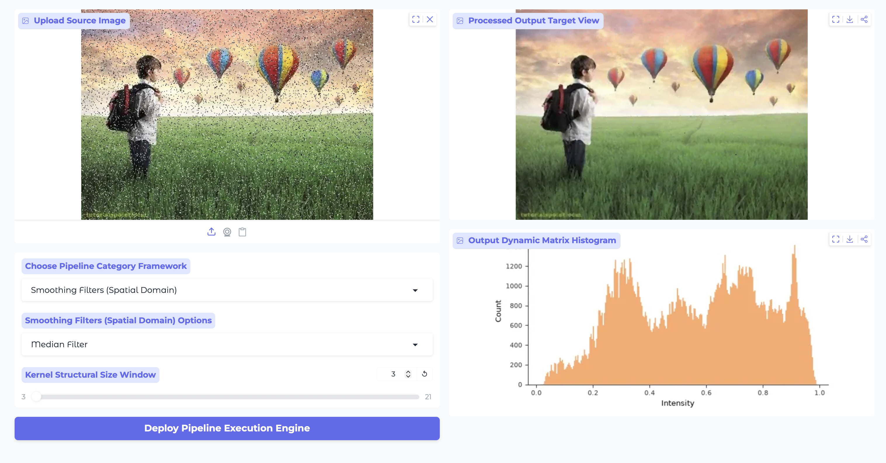
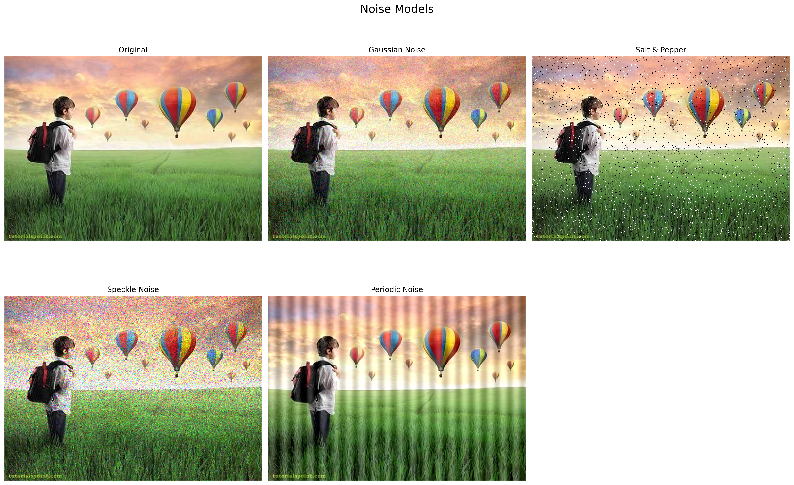
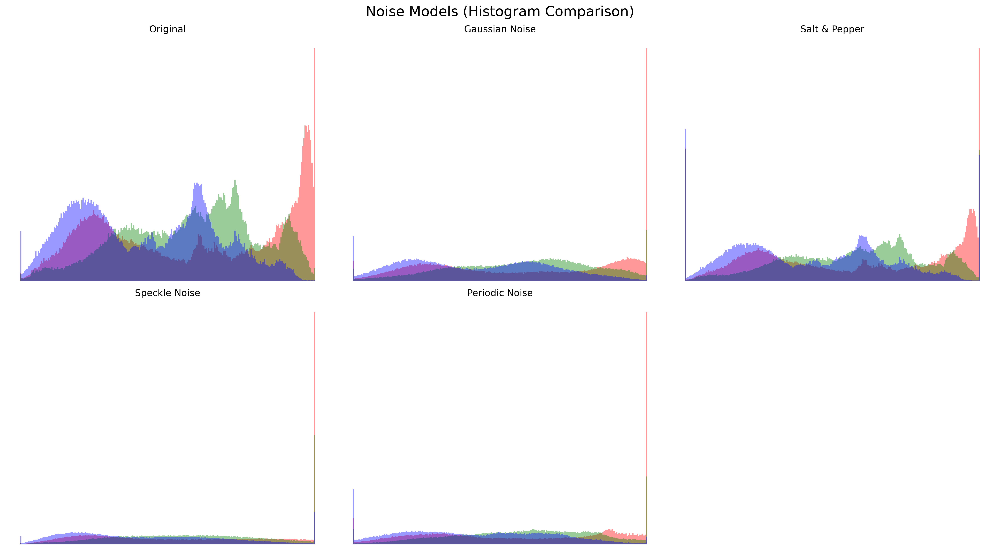
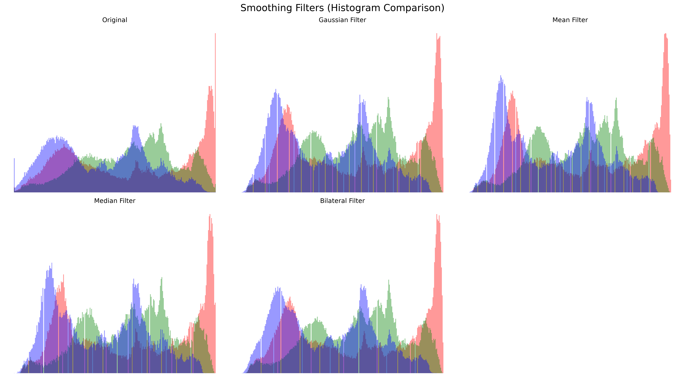
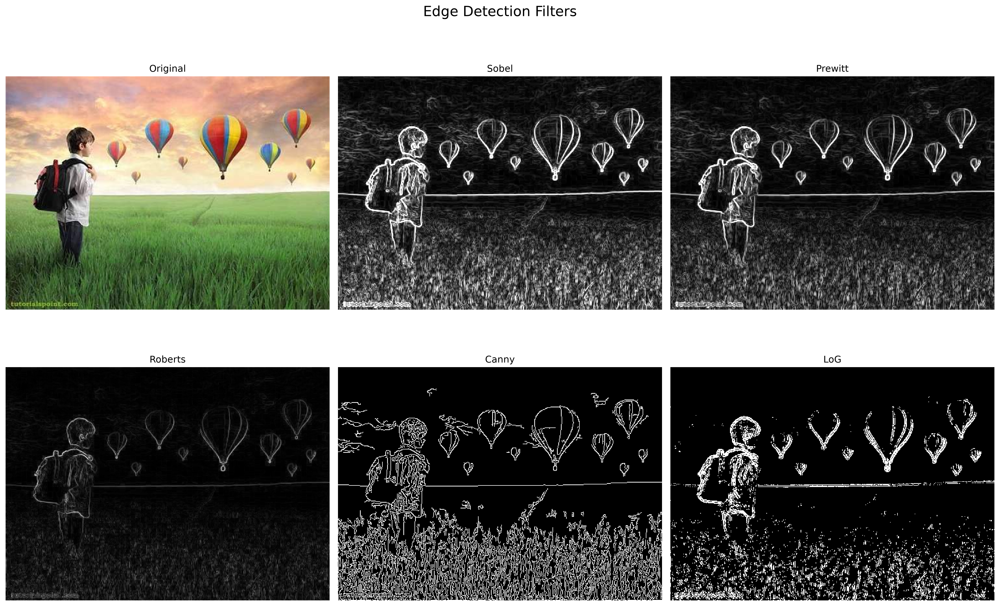
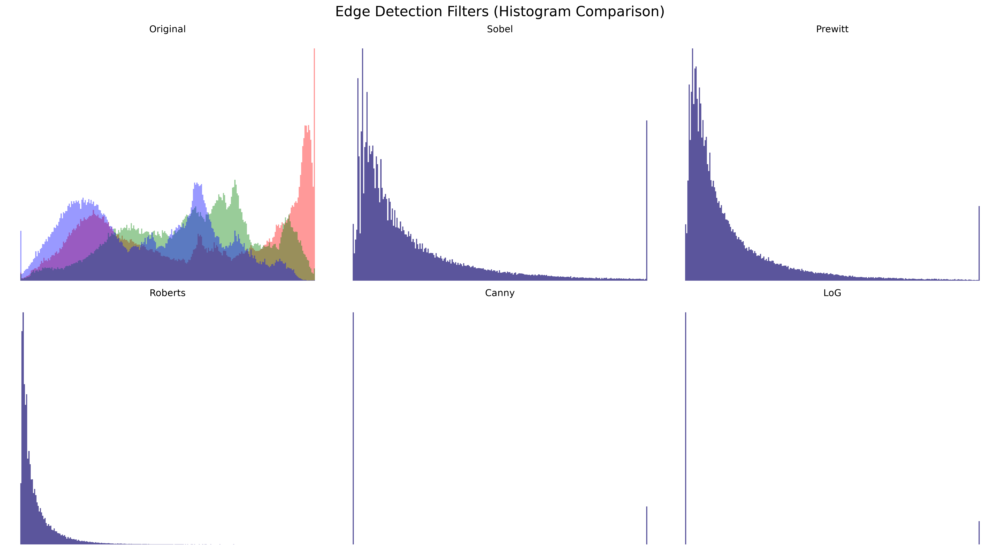
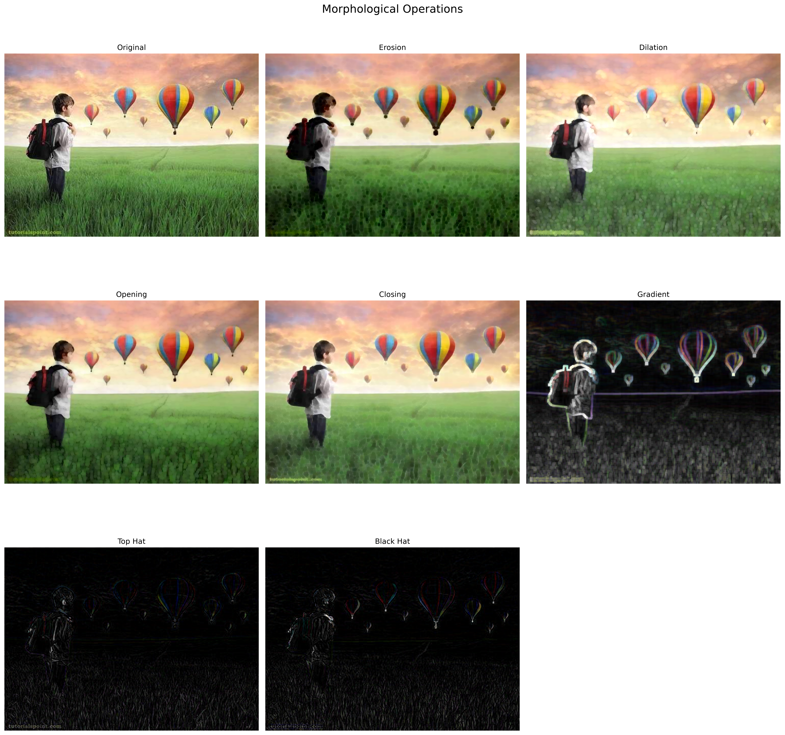
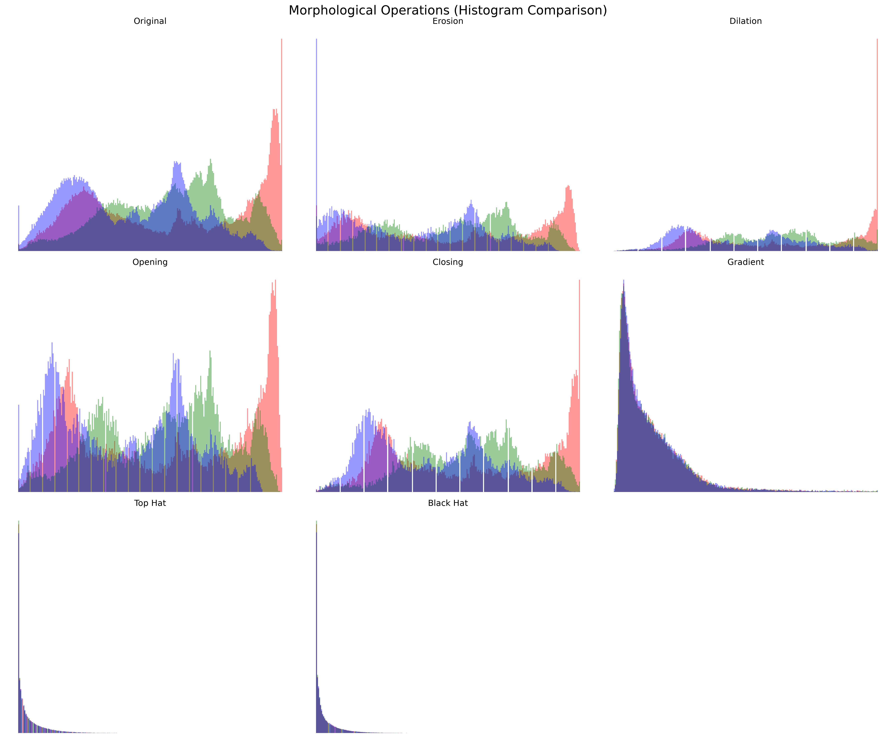

# Image Processing Studio

A Python-based image proce
ssing applic
ation built with OpenCV and Gradio that allows users to experiment with a wide range of computer vision techniques through an interactive web interface.
This project was developed to explore core image processing concepts including enhancement, filtering, segmentation, edge detection, and morphological operations. The application provides a modular environment where different techniques can be applied and compared in real time.


## Structure

```
image-processing/
├── main.py
├── test.py
├── requirements.txt
├── utils/
│   └── helpers.py
└── src/
    ├── enhancement.py
    ├── segmentation.py
    ├── morphological.py
    ├── colorspace.py
    ├── edge_detection.py
    ├── smoothing_filters.py
    └── noise_models.py
```

## Installation

Clone the repository and install the required dependencies:

```bash
git clone https://github.com/Zeinab-Razmi/image-processing.git
cd image-processing
pip install -r requirements.txt
```

## Running the Application

Start the Gradio web interface:

```bash
python main.py
```
The application will launch locally in your browser, allowing you to upload images and experiment with different image processing techniques interactively.

## How it Works

The app gives you a real-time, interactive dashboard split into two main sections: a control panel on the left to tweak your settings, and a live preview/diagnostic area on the right. 

Whenever you run an image through the app, the data flows behind the scenes into a central routing function (`core_routing_pipeline`) that maps your choices to optimized OpenCV and NumPy code.

### 1. The Control Panel (Left Side)
* **Image Sources:** You can upload a standard image file from your local machine, or use your webcam to capture a live frame directly within the UI.
* **Framework Selection:** You start by picking a general category (like "Smoothing Filters" or "Edge Detection"). The app dynamically updates the sub-options so you only see settings relevant to what you're trying to do.
* **Smart Adjustments:** The settings sliders change on the fly. For instance, if you're using a Morphological or Smoothing filter, it opens up a Kernel Size window (automatically keeping it to odd numbers like $3 \times 3$, $5 \times 5$, etc.). If you switch to Canny Edge Detection, those sliders swap out for low/high threshold controls.
* **Execution:** Clicking the **"Deploy Pipeline Execution Engine"** button fires off the calculations instantly.

### 2. Live Diagnostics (Right Side)
* **Processed Output View:** You get a side-by-side visual comparison right away. It lets you quickly see exactly how your settings altered the image—whether that’s wiping out noise, finding crisp edges, or shifting color spaces.
* **Dynamic Histogram:** Below the output, the app renders a live pixel-intensity histogram. It maps the pixel density against a normalized range of $[0.0, 1.0]$. This is incredibly helpful for checking the contrast, seeing how values are clustering, or visualizing where a threshold split happened.

* 

## Features

### Image Enhancement
Improve image quality using various **intensity transformation techniques**:
Negative/Inversion, Log Transform, Gamma Correction, Contrast Stretching, Histogram Equalization, and CLAHE (Contrast Limited Adaptive Histogram Equalization).


### Spatial Domain Noise Models
Simulate common image degradations for testing and analysis.
**Operations Included:** Gaussian, Salt-and-Pepper, Speckle, Periodic



### Smoothing Filters
Apply **filtering techniques** to reduce noise while preserving image details:
Mean Filter (Blur), Gaussian Filter, Median Filter, Adaptive Median Filter, and Bilateral Filtering.



### Color Space
Explore different image representations and color perception transformations:
RGB to Grayscale Conversion, RGB to HSV Conversion, White Balance Correction,Deuteranopia (Red-Green Color Blindness) Simulation


### Image Segmentation
Separate objects and regions using thresholding and clustering methods.
**Intensity-based Thresholding:** Global Thresholding, Otsu’s Method, Multi-Otsu Thresholding, Adaptive Mean, and Adaptive Gaussian Thresholding.
**Clustering Bins:** K-Means


### Edge Detection
Identify image boundaries and structural features:
**Operations Included:** Sobel Gradient Filter, Prewitt Operator, Roberts Cross Detector, Canny Edge Detector (with dual-threshold hysteresis controls), and Laplacian of Gaussian (LoG).



### Morphological Processing
Perform shape-based image processing tasks:
**Operations Included:** Erosion, Dilation, Opening, Closing, Morphological Gradient, Top-Hat Transform, Black-Hat Transform.

